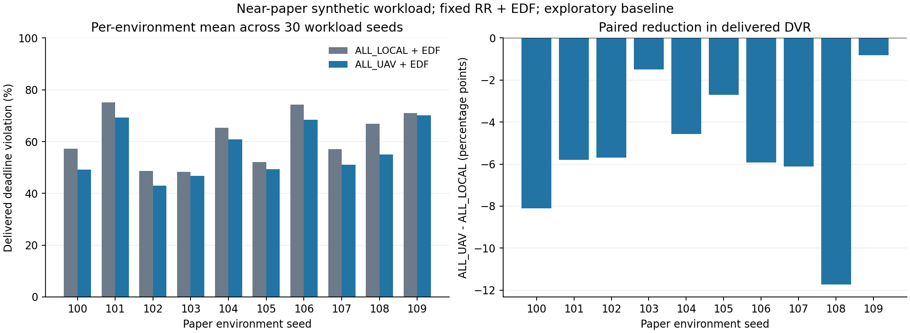

# Kết quả baseline offloading qua 10 môi trường paper

Ngày 01/11/2026. Hoàn tất bước đọc trace cũ và bước kiểm tra nhiều môi trường theo
[plan đã khóa](NEAR_PAPER_MULTILAYOUT_PLAN.md).

## Đã làm gì?

1. Phân tích reference layout 42 từ trace cũ, **không chạy lại baseline đó**:
   421 task giữ thành công, 37 được cứu, 0 bị hại, 274 thất bại ở cả hai nhánh.
   Trong 37 task được cứu: 18 vốn không đủ thời gian compute local, 19 vốn compute local
   đúng hạn nhưng nguồn disconnected.
2. Smoke cho campaign nhiều layout: 10 episode, audit PASS.
3. Chạy **1.500 episode = 10 môi trường × 30 workload seed × 5 routing baseline**.
   Đủ **36.600 task outcomes**, audit độc lập từng run và tổng hợp PASS; process exit code 0.
4. Phân tích paired task rescues/harms, energy components, queue opportunities, runtime và crossed bootstrap CI.
5. 25 script regression tests PASS; simulator/baseline Java không sửa ở bước này.

Protocol giữ nguyên primary: RR + EDF, deadline 600 s, radio/CPU/battery/dwell/horizon như trước.
Không chạy background Alibaba hoặc inference RescueNet. Task synthetic 2–4 MB theo nhánh gần paper.

Mỗi environment seed 100–109 thay **tọa độ, hardware, loại vision task, pin và connectivity**
theo PaperSimulation.layout. Không gọi đây là chỉ đổi geometry.
Seeds 0–29 là workload seeds dùng chung, workload CSV/hash giống nhau giữa mọi arm/environment.
Các seed 110–119 ghi dự phòng trong plan, chưa chạy ở campaign này.

## Kết quả tổng hợp

| Routing, giữ RR + EDF | Compute DVR % | Delivered DVR % | J / ảnh giao đúng hạn | Mean / P95 delivered latency s | Tổng / UAV kJ mỗi episode | Ảnh giao đúng hạn |
|---|---:|---:|---:|---:|---:|---:|
| ALL_LOCAL | 43,12 | 61,61 | 31.329 | 300,45 / 917,84 | 292,41 / 218,74 | 2.800 |
| ALL_UAV | 39,57 | 56,31 | 27.031 | 262,21 / 890,81 | 286,62 / 214,01 | 3.181 |
| SHORTEST_FINISH | 38,91 | 55,80 | 27.020 | 252,00 / 884,45 | 290,20 / 217,53 | 3.222 |
| DEADLINE_ENERGY | 38,92 | 55,40 | 26.738 | 252,35 / 884,45 | 289,75 / 217,12 | 3.251 |
| DELIVERY_AWARE | 38,92 | 55,40 | 26.738 | 252,35 / 884,45 | 289,75 / 217,12 | 3.251 |

DVR/latency là trung bình đều theo episode; P95 là mean episode P95 trên task delivered,
không phải pooled percentile. Latency gồm cả task đã giao muộn, vì vậy có thể vượt budget 600 s.
J/ảnh là tỷ số tổng năng lượng / tổng ảnh đúng hạn, không phải trung bình các tỷ số.
Không gộp drop vào latency của completions.

**Primary contrast ALL_UAV − ALL_LOCAL:** delivered DVR giảm **5,30 điểm %**,
CI 95% exploratory **[−7,55; −3,25] điểm %**.
J/ảnh delivered giảm khoảng **13,72%**.

CI resample hai yếu tố environment và shared workload seed bằng crossed bootstrap 5.000 lượt,
giữ paired policy. **Không coi 1.500 policy episode là 1.500 mẫu độc lập**.
Chỉ 10 environment, chưa xác nhận holdout hoặc tuyên bố SOTA.
Không dùng CI so với ALL_LOCAL để khẳng định DEADLINE_ENERGY thắng ALL_UAV có ý nghĩa thống kê;
muốn kết luận đó phải làm đúng contrast.

ALL_UAV giảm delivered DVR ở **10/10 environment** đã lấy mẫu, mức giảm **0,81–11,74 điểm %**.
Chênh lệch metric tuyệt đối so với layout 42 không có nghĩa simulator bị đổi:
hardware/task/connectivity của môi trường đã khác. Không so lẫn absolute DVR giữa hai setting.

## Offloading có gây hại không?

| So với ALL_LOCAL, cùng (environment, workload seed, task id) | Được cứu | Bị hại |
|---|---:|---:|
| ALL_UAV | 415 | 34 |
| SHORTEST_FINISH | 422 | 0 |
| DEADLINE_ENERGY | 451 | 0 |
| DELIVERY_AWARE | 451 | 0 |

ALL_UAV có 34 task thất bại dù ALL_LOCAL đã giao đúng hạn:
- **32 task:** upload riêng đã vượt deadline.
- **2 task:** tổng chờ contact + upload + compute tối thiểu vượt deadline.

Đây là phân loại lower-bound trên route thực thi, không phải proof một nguyên nhân nhân quả duy nhất.
Rescued/harmed là tác động toàn policy, có thể gồm thay đổi contact/queue.
Không suy diễn guarantee rằng baseline thông minh luôn không gây hại ngoài các môi trường đã chạy.

Các baseline có dự đoán finish/deadline đã tránh nhóm hại ở đợt này.
Vì vậy **chỉ thêm kiểm tra upload/deadline chưa đủ thành đóng góp thuật toán mới**.
DEADLINE_ENERGY và DELIVERY_AWARE cùng kết quả core metrics trong campaign,
không phải hai bằng chứng độc lập.

## Energy và scheduler

ALL_UAV − ALL_LOCAL, mean/episode:
- Flight: **−10.282,82 J**.
- Hover: **+5.484,17 J**.
- UAV compute: **+67,80 J**; ground compute: **−1.071,68 J**.
- Ground TX: **+20,29 J**.
- Tổng: **−5.782,24 J**.

Upload pin stop làm thay đổi flight/hover; không gọi toàn bộ energy gain là compute saving.
Chưa kiểm soát flight trajectory cố định để tách isolated compute effect.

ALL_UAV+EDF chỉ **8/691 dispatch** có ≥2 task ready.
Chưa có lý do ưu tiên scheduler phức tạp trong primary này.
Tất cả **300/300 UAV mỗi arm** sống đến horizon 1.800 s: censored, chưa chứng minh lifetime tăng.
Background DVR = NA vì background tắt.
Runtime kernel Java mean khoảng 2–4 ms/episode trên máy Windows hiện tại, chịu JIT/outlier;
không phải timing mỗi quyết định, server benchmark hoặc bằng chứng hardware latency thực.

## Quyết định tiếp theo

**Tập trung offloading; giữ EDF làm scheduler cố định.**
Bước kế tiếp nên là sensitivity đã định trước đối với CPU UAV, deadline và contact/dwell,
dùng DEADLINE_ENERGY/DELIVERY_AWARE cùng SHORTEST_FINISH làm baseline mạnh.
Chỉ chọn cơ chế mới sau khi xác định các failure baseline chưa giải quyết.
Không cần train DQN hoặc bổ sung cache ở bước này.

Đây là bằng chứng trên môi trường synthetic gần paper; chưa tự chuyển thành kết luận trên
RescueNet/Alibaba thật, mô hình radio thực tế hay kết quả DQN/lifetime của paper.

## Tài liệu và lệnh chạy

- [Mô hình gần paper và ranh giới phần mở rộng](NEAR_PAPER_SCENARIO.md).
- [Bảng chi tiết từng environment và bootstrap contrasts](../../docs/experiments/near-paper-layouts-20261101/RESULTS.md).
- [Phân tích task bị hại và energy components](../../docs/experiments/near-paper-layouts-20261101/analysis.md).
- [Phân tích reference từ trace cũ](../../docs/experiments/near-paper-layouts-20261101/reference-diagnosis.md).
- Full trace: target/near-paper-layout-full-20261101.
- Curated artifacts: docs/experiments/near-paper-layouts-20261101, có provenance + SHA-256.

Tại gốc MECSim, với reference đã verified:
~~~powershell
.\.venv-drl\Scripts\python.exe scripts/near-paper-layouts.py prepare --reference target/near-paper-final-20261101 --output target/layouts-new
.\.venv-drl\Scripts\python.exe -u scripts/near-paper-layouts.py run target/layouts-new
.\.venv-drl\Scripts\python.exe scripts/analyze-near-paper-layouts.py target/layouts-new
~~~
Output phải mới. Run tự compile, chạy Java, audit từng environment, xuất mandatory metrics rồi tổng hợp.
Không thay code/protocol sau khi prepare; source drift sẽ bị từ chối.
Trên Linux thay Python executable bằng .venv-drl/bin/python.
Nếu checkout mới chưa có reference: chạy near-paper-study.py với cấu hình near-paper-protocol.json trước,
rồi truyền output verified đó cho --reference.

## Sensitivity đã thực hiện

[Xem kết quả CPU/deadline/dwell](NEAR_PAPER_SENSITIVITY_RESULTS.md): 5.400 episode mới, audit PASS; reference được tái sử dụng, không rerun.
