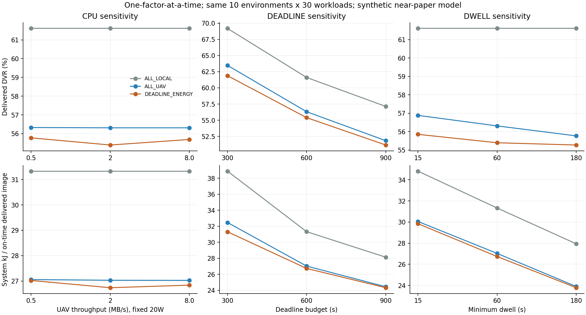

# Kết quả sensitivity gần paper — CPU, deadline, dwell

Đã thực hiện tuần tự CPU → review → deadline → review → dwell → review.
**5.400 episode mới**, **131.760 task outcomes mới**, audit độc lập tất cả PASS.
Tái sử dụng **900 episode reference**; tổng 6.300 analysis cases duy nhất.
Không chạy lại reference, không cộng smoke vào số mẫu full.

## Kết quả của baseline mạnh DEADLINE_ENERGY

Mỗi điểm = 10 environments × 30 workload seeds, giữ RR + EDF.
Mỗi lượt chỉ thay một yếu tố, các mức còn lại ở reference (CPU 2 MB/s, deadline 600 s, dwell 60 s).

| Thay đổi | Delivered DVR % | J / ảnh giao đúng hạn | Mean / P95 delivered latency s |
|---|---:|---:|---:|
| Reference | 55.40 | 26737.62 | 252.35 / 884.45 |
| CPU 0,5 MB/s | 55.78 | 27023.30 | 254.38 / 884.47 |
| CPU 8 MB/s | 55.69 | 26838.70 | 256.27 / 885.81 |
| Deadline 300 s | 61.89 | 31317.09 | 212.01 / 783.47 |
| Deadline 900 s | 51.16 | 24331.39 | 271.45 / 938.63 |
| Dwell 15 s | 55.85 | 29844.74 | 261.21 / 886.15 |
| Dwell 180 s | 55.27 | 23782.30 | 246.65 / 872.82 |

Latency chỉ trên các ảnh thực sự delivered, gồm cả muộn. P95 là mean episode P95.
Không coi drop là completed; J/ảnh là ratio of sums, không phải mean của các ratio.

## Đọc kết quả và quyết định

### 1. CPU UAV chưa là nút thắt chính trong dải đã thử

0,5 / 2 / 8 MB/s cho DVR 55,78 / 55,40 / 55,69%.
Giữ incremental CPU watts ở 20 W: đây là capacity sensitivity, không phải DVFS hoặc hardware đo được.
Không kết luận CPU mạnh hơn luôn kém hơn; policy dùng forecast để đổi route và contact sau đó.

CPU 8 MB/s vs reference, DEADLINE_ENERGY:
51 route changes, 17 episode đổi visit trace; 0 task thêm delivered ontime và 22 task mất ontime.
Đó là dữ liệu paired của policy đã thực thi, không phải benchmark hardware inference.
CPU phase negative control ALL_LOCAL task/energy/position/visit/update traces byte-identical reference: PASS.

### 2. Deadline ảnh hưởng mạnh nhưng không phải biến để làm đẹp kết quả

300 / 600 / 900 s cho DVR 61,89 / 55,40 / 51,16%.
Nới deadline giảm lỗi vì thay yêu cầu chấp nhận task, không chứng minh thuật toán chạy nhanh hơn.
Giữ 600 s làm reference giả định; chưa gọi đó là SLA ứng dụng thực.

### 3. Dwell chủ yếu thay đổi energy trong các mức này

15 / 60 / 180 s cho DVR 55,85 / 55,40 / 55,27%.
So với reference, CI delivered DVR của dwell đều chứa 0:
15 s: +0,46 điểm % [−0,82; +1,81]; 180 s: −0,12 điểm % [−2,28; +1,75].

Dwell 180 s làm J/ảnh thấp hơn, nhưng ALL_LOCAL cũng giảm energy khi dwell tăng.
Phần lớn đó là đổi tỷ lệ flight/hover và lịch contact, không thể gán riêng cho thuật toán offloading.
Không tự đổi reference sang dwell 180 s chỉ vì energy thấp hơn.

### 4. Scheduler vẫn ít cơ hội quyết định

Với DEADLINE_ENERGY, số dispatch có >=2 task ready:
- Reference: 8 / 716.
- CPU 0,5 MB/s: 7 / 631.
- CPU 8 MB/s: 0 / 713.
- Deadline 300 s: 9 / 718.
- Deadline 900 s: 8 / 727.
- Dwell 15 s: 17 / 663.
- Dwell 180 s: 7 / 719.

Chưa có cơ sở thêm scheduler phức tạp vào primary này. Giữ EDF.
Không suy rộng rằng scheduler không bao giờ hữu ích với CPU/tải khác chưa thử.

## Thống kê và giới hạn

- Crossed bootstrap 5.000 lần theo environment và shared workload seed, giữ paired policy/settings.
  Không coi 5.400 policy episode là mẫu độc lập; CI exploratory, không phải confirmatory multiple-testing result.
- Báo đủ ALL_LOCAL / ALL_UAV / DEADLINE_ENERGY ở mỗi setting; per-environment nằm trong summary.csv.
- Chênh lệch DEADLINE_ENERGY vs ALL_UAV không có CI loại 0 ở mọi setting; không tuyên bố luôn thắng.
- **300/300 UAV mỗi arm/setting còn sống tới 1.800 s**: censored; chưa chứng minh lifetime tăng.
- Background DVR NA (background tắt); không inference RescueNet. Task synthetic 2–4 MB và bảng throughput local theo nhánh paper.
- Mỗi environment seed đổi cả geometry, hardware/vision task, battery, connectivity; không chỉ tọa độ.
- Radio ambiguity, independent full bandwidth, zero output delay và chưa thu gom kết quả local disconnected vẫn còn.
- Runtime kernel Java có lưu; reference timing từ process cũ. Không dùng để xếp hạng settings, timing mỗi quyết định hoặc hardware inference.
- 30 script regression tests PASS; smoke 36 episode mới + 6 reference reused PASS.
  Smoke CPU phát hiện lỗi ghi completion status ở orchestration; đã sửa trước full, tái dùng trace smoke đã audit.
  Không tính các trace reuse thành sample độc lập.
- Simulator/baseline Java không thay trong đợt sensitivity này. Không train DQN, không đổi config để ép scheduler có lợi.

## Hướng tiếp theo

Giữ reference và DEADLINE_ENERGY làm baseline mạnh. Chưa cần tăng CPU hoặc train DQN.
**Giả thuyết nên kiểm chứng tiếp:** quyết định offloading cần tính cả ảnh hưởng của upload
lên thời gian dừng/lịch contact, thay vì chỉ marginal CPU + TX của task hiện tại.
Đây là giả thuyết đóng góp, chưa phải thuật toán mới đã triển khai hoặc được xác nhận.

Trước khi làm cơ chế mới:
1. Tách phần dự đoán chi phí task và chi phí giữ UAV tại stop từ context causal hiện có.
2. Đánh giá thiết kế trên development đã dùng; không gọi đó là holdout.
3. Khóa cơ chế/ablation rồi mới dùng các environment dự phòng để xác nhận.
Không tự thêm cache, dataset mới hoặc nhiều objective chỉ để mở rộng phạm vi.

## Tài liệu và cách tái lập

- [Plan đã khóa trước chạy](NEAR_PAPER_SENSITIVITY_PLAN.md).
- [Kết quả đủ ba policy / bảy setting](../../docs/experiments/near-paper-sensitivity-20261101/RESULTS.md).
- [Nguồn baseline nhiều môi trường](NEAR_PAPER_MULTILAYOUT_RESULTS.md).
- Full traces: target/near-paper-sensitivity-full-20261101.
- Curated evidence: docs/experiments/near-paper-sensitivity-20261101, có hashes/provenance.
- Cần full reference traces đã verified; summary CSV riêng không đủ để chạy audit hoặc negative control.

~~~powershell
.\.venv-drl\Scripts\python.exe scripts/near-paper-sensitivity.py prepare --reference target/near-paper-layout-full-20261101 --output target/sensitivity-new
.\.venv-drl\Scripts\python.exe -u scripts/near-paper-sensitivity.py run target/sensitivity-new --phase cpu
# Đọc phases/cpu/RESULTS.md và cpu-review.json trước bước tiếp.
.\.venv-drl\Scripts\python.exe -u scripts/near-paper-sensitivity.py run target/sensitivity-new --phase deadline
# Đọc deadline review trước bước cuối.
.\.venv-drl\Scripts\python.exe -u scripts/near-paper-sensitivity.py run target/sensitivity-new --phase dwell
.\.venv-drl\Scripts\python.exe scripts/near-paper-sensitivity.py report target/sensitivity-new
.\.venv-drl\Scripts\python.exe scripts/report-near-paper-sensitivity.py target/sensitivity-new
~~~

Output phải mới; source/protocol drift bị từ chối. Trên Linux thay executable bằng .venv-drl/bin/python.
Không cần tải thêm dataset cho đợt sensitivity synthetic này.
