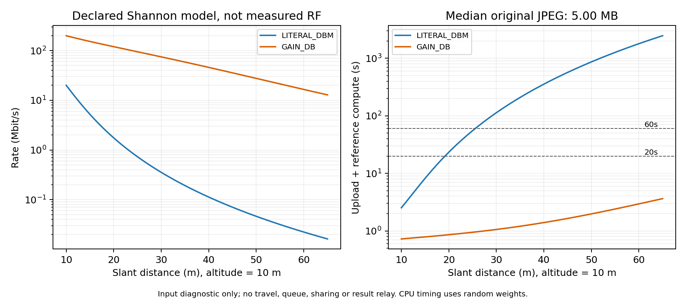

# Audit radio và upload delay — 01/11/2026

**Đã kiểm tra implementation và input; chưa hiệu chuẩn đường truyền thực.**
Không sửa PaperParameters, kernel, protocol mặc định, dataset hay kết quả thí nghiệm cũ.
Đây là input diagnostic, không phải phép so sánh thuật toán.

## Những gì đã xác nhận

Đọc trực tiếp Section 4, trang PDF 7–8, Eq.(4), Table 1 của
[paper gốc](../../../2501.15305v1.pdf), đối chiếu [bản trích xuất](../../../2501.15305v1.md).
Bảng công bố W=20 MHz, p=0,1 W, noise=-100 dBm, beta0=-50 dBm, theta=4,
H=10 m, range=65 m.

Code mặc định tính:

- noise power = 10^((-100-30)/10) = 1e-13 W, không bình phương lại hay nhân W lần nữa.
- hệ số tham chiếu theo literal dBm = 10^((-50-30)/10) = 1e-8.
- SNR = p × hệ số tham chiếu × d^(-4) / noise.
- R = W × log2(1+SNR), bit/s; không có interference nên đây là SNR, không phải SINR có nhiễu liên kết.
- Upload = số byte file JPEG × 8 / R.
- d là khoảng cách 3D: sqrt(dx²+dy²+H²), source ở z=0.
  Range 65 m là khoảng cách xiên; bán kính ngang tương ứng khoảng 64,23 m.

Các ca tính tay và Java kernel thống nhất với công thức trên.
Chưa thấy bug byte/bit, MHz/Hz hoặc khoảng cách 2D/3D trong đường đã kiểm tra.
Điều này không chứng nhận mô hình RF đúng với một môi trường thiên tai thực.

## Điểm chưa rõ trong paper: beta0

Paper gọi C=beta0*l^(-theta) là channel gain và nhân C với transmit power p,
nhưng Table 1 ghi beta0 có đơn vị dBm. Nếu beta0 thực sự là power (W),
cách nhân này cần quy ước chuẩn hóa để tỷ số SNR không mang đơn vị.
Một hệ số gain -50 dB không thứ nguyên sẽ cho 1e-5, khác 1e-8 của power -50 dBm.

Audit tính cả hai:

- **LITERAL_DBM:** default hiện tại được giữ để đối chiếu.
- **GAIN_DB:** sensitivity với gain 1e-5, chưa được xác nhận là ý định của tác giả,
  không được chọn chỉ vì cải thiện kết quả.

Noise -100 dBm vẫn là 1e-13 W ở cả hai cách; không cộng thêm noise model khác.
Overload rateBps(distance,gain) có sẵn cho probe. Mobile kernel hiện chỉ gọi default;
cấu hình GAIN_DB chưa được nối thành radio option cho campaign mobile.

## JPEG thực lớn hơn task synthetic của paper

449 ảnh trong source pool đều được kiểm tra kích thước file trên đĩa:

| Đại lượng | MB thập phân |
|---|---:|
| Nhỏ nhất | 4,622497 |
| Median | 4,997215 |
| P95 | 7,253089 |
| Lớn nhất | 10,658851 |

Paper dùng task synthetic 2–4 MB. Mô phỏng RescueNet hiện truyền nguyên JPEG gốc,
không phải tensor 512×512 hoặc kết quả 1 kB.
Resize ở inference không tự làm nhỏ payload đã truyền. Muốn gửi ảnh resize/compress,
phải thêm preprocessing ở source, đo bytes/cost và kiểm tra accuracy tương ứng;
đó là adaptation riêng.

## Tốc độ và upload theo default

| Khoảng cách xiên | Rate | Upload JPEG median | Upload JPEG P95 |
|---|---:|---:|---:|
| 10 m | 20 Mbit/s | 1,999 s | 2,901 s |
| 20 m | 1,749 Mbit/s | 22,854 s | 33,171 s |
| 40 m | 0,11249 Mbit/s | 355,386 s | 515,817 s |
| 65 m | 0,01616 Mbit/s | 2.473,936 s | 3.590,736 s |

Đây là thời gian tải đầy đủ lý thuyết khi UAV hover và link được giữ nguyên.
Kernel thực có thể expire/drop trước đó; không nói simulator đã thực sự truyền
liên tục 2.474 s trong một episode horizon 600 s.

Với GAIN_DB, rate tại 65 m khoảng 12,835 Mbit/s và JPEG median upload khoảng 3,115 s.
SNR đổi 1000 lần nhưng rate không đổi đúng 1000 lần do log.
Bảng đầy đủ: [rates-and-upload.csv](../../docs/radio/20261101/rates-and-upload.csv).

## Vùng phục vụ có ích theo deadline

Dùng compute tham chiếu 0,524349 s từ architecture timing với random weights,
chưa có accuracy/trained-checkpoint claim. Bỏ qua flight, queue, contention, pin và relay.
Giải bất đẳng thức upload(d)+compute <= budget để có cận lạc quan từng task.

| Deadline | Max slant cho JPEG median | Bán kính ngang tương ứng |
|---|---:|---:|
| 10 s | 15,88 m | 12,33 m |
| 20 s | 19,19 m | 16,38 m |
| 60 s | 25,52 m | 23,48 m |
| 120 s | 30,43 m | 28,74 m |

“Max cho JPEG median” không đảm bảo ảnh P95/lớn nhất, cũng không đảm bảo mọi ảnh
hoàn thành đồng thời. Khoảng cách hữu ích là cận trên; queue/flight làm nó nhỏ hơn.

Ở layout42 tại mỗi waypoint, xét các cặp target/source khác nhau (132 cặp có hướng):
compact 250 m có 36 cặp trong coverage nhưng chỉ 4 cặp đạt deadline20 s cho ít nhất
nửa source pool; wide 800 m có 4 cặp trong coverage, 2 cặp đạt tiêu chí đó.
Đây là geometry probe tại các waypoint, không phải phân phối vị trí UAV theo policy
hay tần suất offload thực tế. Các cặp self-target d=10 m được loại khỏi số đếm này.

## Semantics trong simulator cần giữ chung khi so sánh

- Chỉ upload khi hover, trong coverage và stop còn mở. Không upload dọc đường bay.
- allowContactWait cho phép đợi đích đang được chọn; không biết trước các chuyến chưa chọn.
- Upload đang chạy/reserved có thể giữ stop; đóng stop không nhận upload mới.
  Upload kết thúc, deadline expiry hay depletion sẽ giải phóng điều kiện giữ.
- Mỗi upload có toàn bộ 20 MHz độc lập. Không chia sẻ bandwidth, không hàng đợi radio,
  không fading, LoS/NLoS, interference hay PHY/MAC overhead.
- TX = 0,1 W × thời gian thực truyền; contact wait không tính là TX.
  Chưa có RX energy hoặc result-return transmission.
- Local disconnected vẫn có thể compute xong mà không delivery; compute DVR và delivered DVR khác nhau.
- ALL_UAV vẫn fallback LOCAL nếu không có contact hợp lệ; không coi tên policy là bảo đảm tất cả task lên UAV.

## Xác minh và cách chạy lại

- 32 Java tests liên quan pass: RadioUploadAuditTest (3), MobileServiceTest (17),
  PaperSimulationTest (12).
- 3 Python tests cho rate/inverse/corruption pass.
- 16 rate points production Java khớp phép tính Python độc lập.
- Probe kernel xác nhận trong coverage vẫn có thể expire, ngoài range fallback local,
  hai upload đồng thời có full bandwidth và TX energy đúng thời gian truyền.
- 449 JPEG size checks, 576 link rows (2 layout × 12 target × 12 source × 2 convention).
- Hash physical/default sources khớp trước audit; không có algorithm evaluation/training.
- Không chạy lại toàn bộ Java/Python suite vì production không đổi; receipt chỉ nhận
  những kiểm tra thực sự đã chạy trong task này.

~~~powershell
mvn -o -Dtest=RadioUploadAuditTest,MobileServiceTest,PaperSimulationTest -Dradio.auditOutput=target/radio-kernel-new.json test
.\.venv-drl\Scripts\python.exe scripts/test_radio_upload_audit.py
.\.venv-drl\Scripts\python.exe scripts/audit-radio-upload.py --kernel-checks target/radio-kernel-new.json --output target/radio-audit-new
~~~

Dùng tên output mới cho cả kernel probe và audit.
[Evidence/receipt](../../docs/radio/20261101/README.md),
[thiết kế thí nghiệm tiếp theo](SCHEDULING_EXPERIMENT_DESIGN.md).
