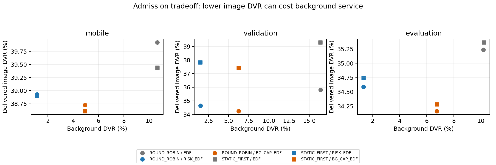

# Kết quả tuần tự: chẩn đoán → admission ablation → validation → evaluation

**Đã hoàn tất các bước theo thứ tự, giữ nguyên ngưỡng sau development.**
Đây là evidence về một cơ chế có đánh đổi, chưa phải thuật toán mới được chứng minh vượt trội.

## 1. Chẩn đoán trước khi sửa code

Phân tích194.392 image outcomes từ2.640 episode cũ, không thay input/output.
Hover/EDF có2.627 ảnh trễ đều bị overlap bởi background;94,9% thời gian blocking đó do background bắt đầu trước khi ảnh sinh.
Mobile/RR/ALL_UAV/EDF:2.600 ảnh local on-time nhưng disconnected;790 upload-compute intrinsic;42 contact-wait intrinsic;104 CPU misses.
Đây là nhóm quan sát theo hierarchy, không phải counterfactual causal attribution. Flags no-contact chồng lấp không cộng vào exclusive counts.

## 2. Cơ chế thử nghiệm

BG_CAP_EDF từ chối background estimated runtime vượt B trước khi bắt đầu CPU; task bị từ chối vẫn là failure.
B=critical image deadline−max JPEG upload tại10m−reference image compute. Không xem future tasks hoặc actual work.
B khoảng5,212/15,212/35,212s cho tight/reference/relaxed; không tuning theo score.
So EDF, PRIORITY, RISK_EDF, RISK_SPT, cap-only và risk+cap trên development.
Đây là admission có dự trữ ngân sách blocking, không phải pure ordering hay preemption.
Không claim novelty/SOTA từ việc thêm guard. RISK_EDF là baseline mạnh đã tồn tại.

## 3. Thiết kế và số lần chạy

| Run | Partition | Full episodes | Verified task outcomes |
|---|---|---:|---:|
| hover | development | 2160 | 204930 |
| mobile | development | 1440 | 151320 |
| validation | validation | 1440 | 152160 |
| evaluation | evaluation | 1440 | 150048 |

Development hover:12setting×6arm×30seed; mobile:4setting×12arm×30seed.
Heldout mỗi partition:2 geometry mới×2 area scale×2load×6arm×30task seed.
Validation dùng geometry seeds104729/104743; evaluation130363/130367, khác development42.
Mỗi geometry scale250/800m không phải hai layout độc lập; chỉ2 geometry/partition, chưa phải30 độc lập.
Source pools RescueNet/Alibaba vẫn dùng chung; đây là task-seed+geometry holdout, không source holdout.
Khóa source, candidate, ngưỡng, metric và cả hai protocol trước algorithm outcomes validation/evaluation.
Validation không dùng để chỉnh ngưỡng/chọn policy; evaluation chạy nguyên lock. Raw source/hash verification giữ trong artifact.
Tất cả arm mobile dùng ALL_UAV, có fallback LOCAL ngoài contact; STATIC_FIRST và RR là hai selector riêng.
Trong cùng selector/case, verifier đã kiểm tra service trajectories giống nhau giữa các scheduler/admission arms.

## 4. Kết quả tổng hợp

| Run / policy | Image DVR % | Delivered DVR % | J/ảnh on-time | J/ảnh delivered | Background DVR % |
|---|---:|---:|---:|---:|---:|
| hover / ALL_UAV__BG_CAP_EDF | 0.000 | NA | 725.076 | NA | 7.237 |
| hover / ALL_UAV__EDF | 10.192 | NA | 827.873 | NA | 6.914 |
| hover / ALL_UAV__PRIORITY | 10.073 | NA | 826.699 | NA | 7.025 |
| hover / ALL_UAV__RISK_BG_CAP_EDF | 0.000 | NA | 725.076 | NA | 7.237 |
| hover / ALL_UAV__RISK_EDF | 2.346 | NA | 751.146 | NA | 0.986 |
| hover / ALL_UAV__RISK_SPT | 2.483 | NA | 752.178 | NA | 0.986 |
| mobile / ROUND_ROBIN__ALL_UAV__BG_CAP_EDF | 9.492 | 38.728 | 1155.939 | 1712.193 | 4.931 |
| mobile / ROUND_ROBIN__ALL_UAV__EDF | 10.686 | 39.922 | 1207.080 | 1799.232 | 10.650 |
| mobile / ROUND_ROBIN__ALL_UAV__PRIORITY | 10.697 | 39.933 | 1207.232 | 1799.571 | 10.673 |
| mobile / ROUND_ROBIN__ALL_UAV__RISK_BG_CAP_EDF | 9.492 | 38.728 | 1155.930 | 1712.179 | 4.931 |
| mobile / ROUND_ROBIN__ALL_UAV__RISK_EDF | 9.693 | 38.929 | 1172.340 | 1738.372 | 1.156 |
| mobile / ROUND_ROBIN__ALL_UAV__RISK_SPT | 9.717 | 38.953 | 1172.631 | 1739.014 | 1.156 |
| mobile / STATIC_FIRST__ALL_UAV__BG_CAP_EDF | 10.786 | 38.609 | 916.666 | 1335.781 | 4.931 |
| mobile / STATIC_FIRST__ALL_UAV__EDF | 11.618 | 39.441 | 961.749 | 1407.491 | 10.650 |
| mobile / STATIC_FIRST__ALL_UAV__PRIORITY | 11.619 | 39.442 | 961.751 | 1407.493 | 10.650 |
| mobile / STATIC_FIRST__ALL_UAV__RISK_BG_CAP_EDF | 10.786 | 38.609 | 916.662 | 1335.775 | 4.931 |
| mobile / STATIC_FIRST__ALL_UAV__RISK_EDF | 11.076 | 38.899 | 933.710 | 1362.679 | 1.156 |
| mobile / STATIC_FIRST__ALL_UAV__RISK_SPT | 11.130 | 38.953 | 934.297 | 1363.935 | 1.156 |
| validation / ROUND_ROBIN__ALL_UAV__BG_CAP_EDF | 5.653 | 34.242 | 1127.808 | 1617.681 | 6.249 |
| validation / ROUND_ROBIN__ALL_UAV__EDF | 7.213 | 35.803 | 1195.252 | 1727.467 | 16.398 |
| validation / ROUND_ROBIN__ALL_UAV__RISK_EDF | 6.052 | 34.641 | 1152.396 | 1655.945 | 1.511 |
| validation / STATIC_FIRST__ALL_UAV__BG_CAP_EDF | 6.460 | 37.435 | 858.319 | 1282.594 | 6.249 |
| validation / STATIC_FIRST__ALL_UAV__EDF | 8.329 | 39.303 | 924.739 | 1396.366 | 16.386 |
| validation / STATIC_FIRST__ALL_UAV__RISK_EDF | 6.857 | 37.831 | 882.017 | 1320.666 | 1.499 |
| evaluation / ROUND_ROBIN__ALL_UAV__BG_CAP_EDF | 6.757 | 34.163 | 1165.547 | 1652.990 | 6.734 |
| evaluation / ROUND_ROBIN__ALL_UAV__EDF | 7.832 | 35.238 | 1215.821 | 1732.703 | 10.177 |
| evaluation / ROUND_ROBIN__ALL_UAV__RISK_EDF | 7.183 | 34.589 | 1187.851 | 1687.616 | 1.335 |
| evaluation / STATIC_FIRST__ALL_UAV__BG_CAP_EDF | 7.413 | 34.282 | 932.125 | 1316.448 | 6.734 |
| evaluation / STATIC_FIRST__ALL_UAV__EDF | 8.498 | 35.367 | 979.912 | 1390.570 | 10.214 |
| evaluation / STATIC_FIRST__ALL_UAV__RISK_EDF | 7.881 | 34.750 | 953.836 | 1349.631 | 1.335 |

DVR là macro mean theo episode; J/image là ratio of sums; latency mean/P95 ở từng run CORE_METRICS.md.
Các bảng raw per-scenario giữ load/geometry/scale; không kết luận từ một bảng gộp.
Lifetime, completed-image latency, counts, total/UAV energy và background DVR đều có trong core-metrics-summary.csv.
Task drop không counted completed; zero-success J/task là NA. UAV survivor censored ở600s.

## 5. Ước lượng ghép cặp so với RISK_EDF

| Run / candidate | Mean delivered/image DVR reduction pp | Paired95% interval pp | Seed units |
|---|---:|---|---:|
| hover / ALL_UAV__BG_CAP_EDF | 2.346 | [1.464; 3.238] | 30 |
| mobile / ROUND_ROBIN__ALL_UAV__BG_CAP_EDF | 0.201 | [0.071; 0.353] | 30 |
| mobile / STATIC_FIRST__ALL_UAV__BG_CAP_EDF | 0.291 | [0.158; 0.424] | 30 |
| validation / ROUND_ROBIN__ALL_UAV__BG_CAP_EDF | 0.399 | [0.211; 0.625] | 30 |
| validation / STATIC_FIRST__ALL_UAV__BG_CAP_EDF | 0.396 | [0.150; 0.683] | 30 |
| evaluation / ROUND_ROBIN__ALL_UAV__BG_CAP_EDF | 0.426 | [0.218; 0.688] | 30 |
| evaluation / STATIC_FIRST__ALL_UAV__BG_CAP_EDF | 0.468 | [0.221; 0.802] | 30 |

Overall CI lấy mean các load/layout trong task seed trước paired bootstrap2000 lần.
Đây là CI conditional trên các layout đã dùng, không CI over population geometry và chưa multiple-testing correction.
Không suy diễn statistical superiority chỉ từ một interval hoặc lẫn compute DVR với delivered DVR.

## 6. Kết luận thực hành

**Không chọn BG_CAP_EDF làm thuật toán cuối ở thời điểm này.**
Cap cải thiện ảnh nhưng phải từ chối thêm background, nhất là các job dài chứa phần lớn CPU work.
Không coi giảm energy bằng việc bớt xử lý background là hiệu quả miễn phí. Xem background-admission-work.csv.
RISK_EDF nên là đối chứng chính cho nghiên cứu tiếp; EDF đơn thuần chưa đủ mạnh.
Mobile còn bị chi phối bởi radio/contact và disconnected delivery; ordering/admission không tự giải quyết được phần đó.
Bước thiết kế tiếp có cơ sở là background có thể pause/resume theo quantum hoặc offloading biết contact,
nhưng phải có checkpoint/context-switch overhead, work-conservation tests và background service constraint trước triển khai.
Chưa tự thêm preemption hoặc đổi payload/radio sau khi xem holdout trong task này.
Nếu tiếp tục dùng chính các seed/layout ở đây để phát triển, chúng trở thành development; cần holdout mới cho kết luận cuối.

## 7. Giới hạn và độ phức tạp

Compute còn random-weight architecture timing; model vision chưa train/đánh giá accuracy, power và deadline chưa calibrated.
Alibaba work là duration×requestedCPU proxy; chưa replay DAG/multi-instance hay real CPU-time.
Cap kiểm tra O(1)/task, quét hàng đợi để admission O(N) trong implementation hiện tại;
EDF chọn min O(K) với K ready tasks. Không suy ra whole-simulator complexity từ riêng selector.
Timer scheduling hiện chỉ đo choose(), không bao gồm admission scan; episode wall time gồm mô phỏng, chưa là deployment decision latency.
Tất cả UAV sống hết horizon600s: lifetime>=600s, chưa có bằng chứng kéo dài lifetime.
Không train DQN/PPO, không yêu cầu GPU hay dataset mới trong lượt này.

