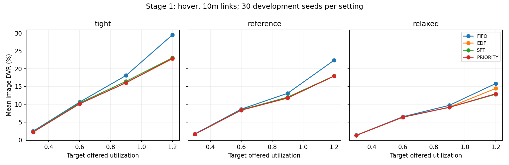

# Thực nghiệm tuần tự: scheduling rồi mobile

**Hoàn tất đúng thứ tự: giai đoạn 1 → đánh giá/chốt thiết kế → smoke và full giai đoạn 2.**
01/11/2026. Development evidence, không phải tái hiện DQN paper hoặc kết quả SOTA.
Compute là architecture timing với random weights; power/deadline/Alibaba work vẫn có giả định.

## 1. Giai đoạn 1: cô lập scheduler

1.440 episode = 4 offered loads ×3 deadline ×4 scheduler ×30 task seeds development.
UAV hover/link10m, ALL_UAV, full original JPEG, 12 nguồn; đây là queue-control abstraction, không phải layout800m.
Independent input/physics/dispatch/routing verifier PASS; exporter bắt buộc đã chạy.
Có 25,719/123,311 lượt dispatch có ít nhất hai ready tasks (20.86%).
Không có image task bất khả thi chỉ do upload+compute đơn lẻ. Có queueing và cơ hội chọn thứ tự.

| Scheduler | Image DVR % | J/ảnh đúng hạn | Mean/P95 latency s | Background DVR % |
|---|---:|---:|---:|---:|
| EDF | 10.192 | 827.873 | 5.812/17.869 | 6.914 |
| FIFO | 11.671 | 841.620 | 6.255/18.794 | 6.908 |
| PRIORITY | 10.073 | 826.699 | 5.446/17.439 | 7.025 |
| SPT | 10.169 | 827.577 | 5.407/17.109 | 6.662 |

DVR/latency là mean đều theo episode; J/ảnh là ratio of sums. Latency chỉ trên task completed (gồm late), P95 tính từng episode rồi lấy mean.
EDF giảm khoảng1,48 điểm phần trăm DVR gộp so FIFO; không đồng nghĩa mọi setting/seed đều tốt hơn.
Ở target rho1,2/reference, EDF giảm4,425 điểm phần trăm; paired bootstrap95% khoảng[2,568;6,724] điểm phần trăm.
Đây là CI exploratory, không phải kiểm định confirmatory đã chỉnh nhiều so sánh.
PRIORITY có image DVR gộp thấp hơn một chút nhưng background DVR cao hơn; không chọn winner chỉ từ một cột.

### Đánh giá trước khi mở giai đoạn 2

Thiết kế giai đoạn1 hợp lệ để khảo sát ordering: link không quyết định failure trước, task/seed ghép cặp, có dispatch choices.
Hiệu ứng scheduler vừa phải. Tải thực chào vào mean ở reference lần lượt0,247/0,493/0,743/1,046 cho target0,3/0,6/0,9/1,2.
CPU busy trong arrival window của EDF khoảng20,9/36,6/50,7/63,6%; offered load khác utilization sau expiry/finite-window effects.
Không retune source pools, seeds hay arrival rate để ép load/algorithm score. Biên bản trước stage2 được lưu ở STAGE1_REVIEW.json.
Chốt stage2 dùng target rho0,9 và1,2, deadline reference20/60s, hai area scales, static và RR controls; thêm routing arm riêng.

## 2. Giai đoạn 2: UAV có di chuyển và contact

1.200 episode = 2 area scales ×2 loads ×10 policy arms ×30 task seeds; layout seed42, không phải30 layout.
STATIC_FIRST: bay đến thiết bị ID0 rồi ở đó, được chốt trước khi nhìn workload; không phải static placement tối ưu.
ROUND_ROBIN: thứ tự ID cố định; stop có thể kéo dài do upload như physical kernel hiện tại.
Tám arm ALL_UAV: 2 selector ×4 scheduler. Verifier xác nhận visit trajectory không đổi khi chỉ thay scheduler trong cùng selector/case.
Hai arm DELIVERY_AWARE+EDF: đối chứng routing riêng; routing có thể làm thay đổi upload pinning và trajectory, không gọi là pure scheduling.
Radio giữ nguyên LITERAL_DBM, full bandwidth cho mỗi upload, không truyền khi bay, contact wait bật chung.
ALL_UAV vẫn fallback LOCAL ngoài contact. Completed local trên source mất kết nối chưa phải delivered result.

| Policy | Compute DVR % | Delivered DVR % | J/ảnh delivered đúng hạn | Delivered mean/P95 s | Mean offloaded images |
|---|---:|---:|---:|---:|---:|
| ROUND_ROBIN__ALL_UAV__EDF | 10.686 | 39.922 | 1799.232 | 1.996/9.965 | 11.450 |
| ROUND_ROBIN__ALL_UAV__FIFO | 10.937 | 40.173 | 1806.690 | 1.937/9.948 | 11.450 |
| ROUND_ROBIN__ALL_UAV__PRIORITY | 10.697 | 39.933 | 1799.571 | 1.991/9.938 | 11.450 |
| ROUND_ROBIN__ALL_UAV__SPT | 10.723 | 39.959 | 1799.947 | 1.957/9.818 | 11.450 |
| ROUND_ROBIN__DELIVERY_AWARE__EDF | 0.034 | 32.887 | 1643.523 | 0.756/0.529 | 0.450 |
| STATIC_FIRST__ALL_UAV__EDF | 11.618 | 39.441 | 1407.491 | 1.861/8.709 | 11.750 |
| STATIC_FIRST__ALL_UAV__FIFO | 11.849 | 39.672 | 1413.010 | 1.810/8.201 | 11.750 |
| STATIC_FIRST__ALL_UAV__PRIORITY | 11.619 | 39.442 | 1407.493 | 1.859/8.708 | 11.750 |
| STATIC_FIRST__ALL_UAV__SPT | 11.661 | 39.484 | 1408.246 | 1.830/8.096 | 11.750 |
| STATIC_FIRST__DELIVERY_AWARE__EDF | 0.261 | 32.494 | 1262.257 | 1.331/5.487 | 0.933 |

### Delivery đến từ đâu?

| Policy | On-time delivery bằng local connected | On-time delivery bằng UAV | Compute xong local disconnected |
|---|---:|---:|---:|
| ROUND_ROBIN__ALL_UAV__EDF | 4862 | 438 | 2600 |
| ROUND_ROBIN__ALL_UAV__FIFO | 4862 | 416 | 2600 |
| ROUND_ROBIN__ALL_UAV__PRIORITY | 4862 | 437 | 2600 |
| ROUND_ROBIN__ALL_UAV__SPT | 4862 | 435 | 2600 |
| ROUND_ROBIN__DELIVERY_AWARE__EDF | 5860 | 51 | 2922 |
| STATIC_FIRST__ALL_UAV__EDF | 4952 | 386 | 2474 |
| STATIC_FIRST__ALL_UAV__FIFO | 4952 | 365 | 2474 |
| STATIC_FIRST__ALL_UAV__PRIORITY | 4952 | 386 | 2474 |
| STATIC_FIRST__ALL_UAV__SPT | 4952 | 382 | 2474 |
| STATIC_FIRST__DELIVERY_AWARE__EDF | 5860 | 88 | 2864 |

### Bao nhiêu offload đã bất khả thi trước khi xếp CPU?

| Policy | Offloaded images | Contact wait + upload + compute vượt deadline | Tỷ lệ |
|---|---:|---:|---:|
| ROUND_ROBIN__ALL_UAV__EDF | 1374 | 832 | 60.55% |
| ROUND_ROBIN__ALL_UAV__FIFO | 1374 | 832 | 60.55% |
| ROUND_ROBIN__ALL_UAV__PRIORITY | 1374 | 832 | 60.55% |
| ROUND_ROBIN__ALL_UAV__SPT | 1374 | 832 | 60.55% |
| ROUND_ROBIN__DELIVERY_AWARE__EDF | 54 | 0 | 0.00% |
| STATIC_FIRST__ALL_UAV__EDF | 1410 | 948 | 67.23% |
| STATIC_FIRST__ALL_UAV__FIFO | 1410 | 948 | 67.23% |
| STATIC_FIRST__ALL_UAV__PRIORITY | 1410 | 948 | 67.23% |
| STATIC_FIRST__ALL_UAV__SPT | 1410 | 948 | 67.23% |
| STATIC_FIRST__DELIVERY_AWARE__EDF | 112 | 0 | 0.00% |

Ví dụ RR+ALL_UAV+EDF có832/1.374 offload đã không thể kịp deadline ngay cả khi bỏ CPU queue.
DA+EDF chỉ offload54 ảnh, không có ảnh thuộc nhóm bất khả thi này;51 ảnh được UAV giao đúng hạn.
Đây là chẩn đoán theo routing thực hiện, không phải cùng tập task UAV giữa hai policy.
Phần lớn delivery của DA đến từ local connected; không xem compute DVR gần0 là đã phục vụ hết source disconnected.

Các số là tổng trên120 case/policy, không phải số task độc lập giữa các policy.
Xem stage2/queue-diagnostics.csv: isolated_infeasible_offloaded_images tính những task có contact wait+upload+compute vượt deadline ngay cả khi CPU không có queue.
Không đồng nhất coverage, offload-eligible, uploaded, compute-completed và delivered. Không loại task thất bại khỏi mẫu.

## Kết luận và giới hạn

Scheduler có tác dụng trong đối chứng CPU có tải; mức cải thiện khi mobile phải đọc kèm số task thực sự lên UAV và điều kiện contact/radio.
Không dùng chênh lệch static/RR hoặc ALL_UAV/DELIVERY_AWARE để quy riêng thành lợi ích CPU scheduler.
Tất cả UAV sống đến horizon600s với pin1.600.000J: lifetime chỉ có cận dưới >=600s; chưa có bằng chứng kéo dài lifetime.
Đây là energy trong model với power giả định, chưa phải energy phần cứng được hiệu chuẩn.
Chưa có checkpoint segmentation đã train, chưa source holdout/unseen layout, chưa validation/evaluation algorithm outcomes, chưa train RL.
Cần xem per-scenario và paired intervals trước khi chọn cơ chế mới. Ưu tiên admission/offloading biết deadline/contact và ordering riêng, kèm ablation, nếu dữ liệu mobile cho thấy radio là nút thắt.
Không chỉnh radio, resize payload hoặc tạo compute dị thể giả để tạo chiến thắng.

## Artifact và tái lập

stage1/ và stage2/ giữ protocol, metric mỗi episode/từng scenario, queue diagnostics, paired bootstrap và verifier receipt.
Raw task/energy/decision/trajectory traces vẫn nằm trong target/sequential-study-20261101, không đưa raw dataset vào Git.
Không gộp88smoke episode với2.640full episode để tăng n. Smoke chỉ kiểm tra pipeline.
Runner mới: PureEdgeSim/uav/offloading/SequentialStudyBenchmark.java; orchestration: drl/sequential_study.py.
Protocol dùng taskSeeds và configs thực; các field legacy template như firstSeed không điều khiển campaign này.
Không dùng script baseline cũ rồi gọi là study này. Mỗi output mới phải chưa tồn tại.
Tạo/chạy/verify stage1 → review-stage1 → prepare-stage2/chạy/verify; prepare-stage2 và Java runner chặn gate thiếu/sai hash.
Chạy lại trên máy khác cần prepare protocol và review mới tại máy đó, không copy đường dẫn gate tuyệt đối từ run này.
