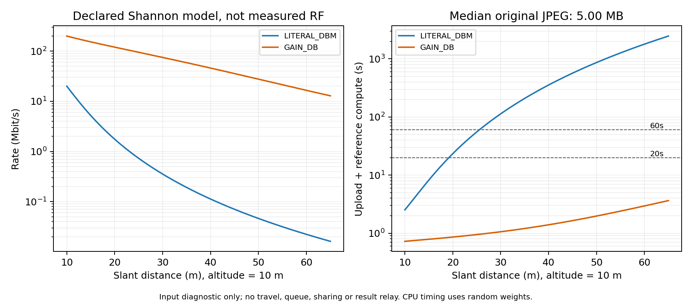

# Radio/upload diagnostic - 1 November 2026

PASS: independent Python vs 16 production Java rate points and kernel coverage/deadline/concurrency probes.
No algorithm evaluated; production defaults and physical kernel unchanged.

Source pool: 449 JPEGs, size median 4.997 MB; min/max 4.622/10.659 MB.
Reference compute = 0.524349s; PROVISIONAL_ARCHITECTURE_TIMING, no trained-model accuracy claim.

## Rate and original-JPEG upload

| Mode | Slant m | Rate Mbit/s | 2MB upload s | Median JPEG upload s | P95 JPEG upload s |
|---|---:|---:|---:|---:|---:|
| LITERAL_DBM | 10 | 20.00000 | 0.800 | 1.999 | 2.901 |
| LITERAL_DBM | 20 | 1.74926 | 9.147 | 22.854 | 33.171 |
| LITERAL_DBM | 40 | 0.11249 | 142.234 | 355.386 | 515.817 |
| LITERAL_DBM | 65 | 0.01616 | 990.126 | 2473.936 | 3590.736 |
| GAIN_DB | 10 | 199.34453 | 0.080 | 0.201 | 0.291 |
| GAIN_DB | 20 | 119.77369 | 0.134 | 0.334 | 0.484 |
| GAIN_DB | 40 | 45.89241 | 0.349 | 0.871 | 1.264 |
| GAIN_DB | 65 | 12.83470 | 1.247 | 3.115 | 4.521 |

## Isolated useful radius

Upload + mean reference compute only. No travel, queue, battery, contention or result return.
Radius quantiles describe the source JPEG pool, not algorithm success.

| Mode | Budget s | Median useful slant m | Median useful ground radius m | Impossible even overhead |
|---|---:|---:|---:|---:|
| LITERAL_DBM | 10 | 15.88 | 12.33 | 0 |
| LITERAL_DBM | 20 | 19.19 | 16.38 | 0 |
| LITERAL_DBM | 60 | 25.52 | 23.48 | 0 |
| LITERAL_DBM | 120 | 30.43 | 28.74 | 0 |
| GAIN_DB | 10 | 65.00 | 64.23 | 0 |
| GAIN_DB | 20 | 65.00 | 64.23 | 0 |
| GAIN_DB | 60 | 65.00 | 64.23 | 0 |
| GAIN_DB | 120 | 65.00 | 64.23 | 0 |

## Interpretation

Byte->bit and slant geometry agree with hand cases. This establishes implementation consistency, not real RF validity.
The paper labels beta0=-50 dBm but uses beta0 inside a channel gain multiplied by transmit watts.
A literal power conversion gives 1e-8; a dimensionless -50dB gain gives 1e-5.
The paper does not resolve this dimensional ambiguity; do not choose the convention to match a winning policy.
Noise is total power 1e-13 W, not squared again and not multiplied by bandwidth again.
Original 4000x3000 JPEG bytes are sent; resizing the inference tensor does not shrink this payload.
Uploads do not occur in flight; known selected destination can reserve a future upload if explicitly enabled.
An active upload pins a hovering stop until completion/expiry/depletion; closure rejects new uploads.
Parallel uploads each get the full 20MHz: no bandwidth sharing, radio queue, fading or measured link adaptation.
Source TX energy=.1W x actual transmission time; contact wait is not TX. RX and result relay costs remain absent.
Out-of-range rate values are diagnostic, not evidence that the kernel executes those links.

## Design recommendation

Keep current LITERAL_DBM reproduction/default. GAIN_DB stays an isolated convention sensitivity until independently justified.
Use a fixed-hover/near-link CPU control before mobile experiments; hold service geometry and routing fixed when changing scheduler.
Use explicit offered-load levels; proposed-queue-loads.csv derives rates from proxy service means, not replayed Alibaba arrivals.
Run static-hover and fixed-route controls in mobile studies, and keep RF/compute/deadline assumptions identical across policies.
Do not call a scenario overloaded from its historical name or claim latency/energy calibrated from this input-only audit.
See the Vietnamese RADIO_UPLOAD_AUDIT and SCHEDULING_EXPERIMENT_DESIGN documents for scope and next actions.
